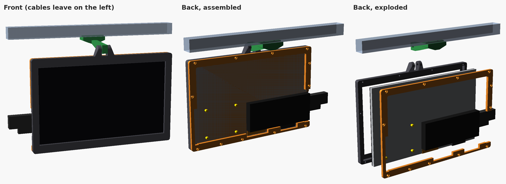
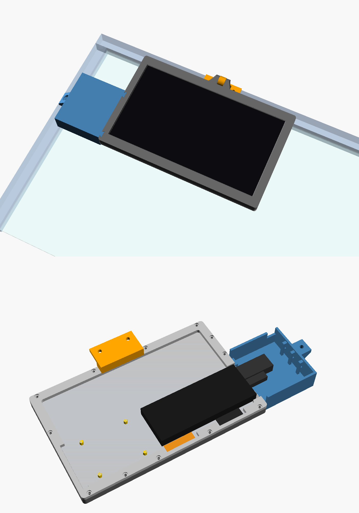
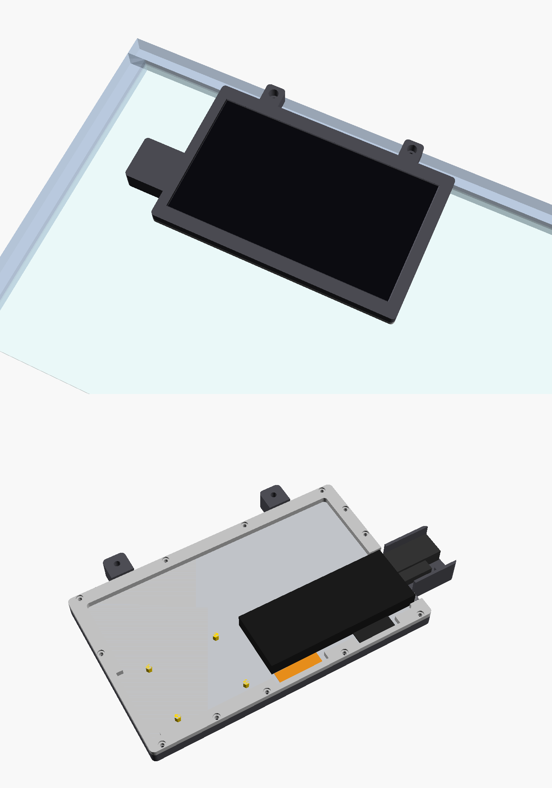
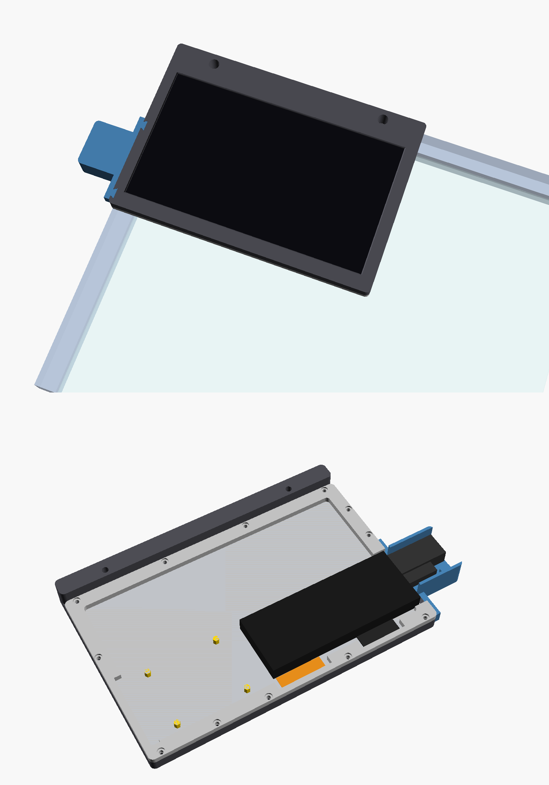

# HMTECH 10.1 Inch HDMI Touch Screen 1024x600 (HM10.1-RP) Case + 2020 Extrusion Mounts

Printable case for the **HMTECH / HAMTYSAN 10.1" HDMI capacitive touchscreen, 1024x600, model HM10.1-RP** (Amazon ASIN [B0987468N2](https://www.amazon.com/dp/B0987468N2)). It's a bare panel with the driver board on the back. HDMI and micro-USB plug in on one short edge. The case leaves room for a Raspberry Pi on the 58 x 49 mm holes on the back.

Four ways to mount it on 2020 aluminium extrusion (built for a Voron 2.4 and its front door). All of them use the same back retainer.

## 1. Hinged, hangs under a 2020 rail

`stl/1 - Hinged (hangs under 2020)/`: bezel, retainer, port guard (box over the HDMI/USB plugs with zip tie posts).
The arm is `hosyond7_arm_bottom.stl` from the [Hosyond 7 inch case](../Hosyond%207%20Inch%20DSI%20Touch%20Screen%20800x480/stl/) (same hinge gap). Hinge bolt: M5x25.

## 2. Door hanger, flat on a 2020-framed door

`stl/2 - Door hanger/`: bezel, retainer, `arm_door` (hangs from the top rail's front face, 2x M5 T-nuts) and `guard_door` (port cover that bolts into the side rail).

## 3. Flush bolt-on, no arm

`stl/3 - Flush bolt-on/`: the bezel has two ears that bolt straight to the front of a 2020 rail (M5x10 + T-nuts).
- `hmtech10_flush_bezel.stl`: one piece with the plug channel built in (290 mm wide, needs a big bed).
- `hmtech10_flush_bezel_x1c.stl` + `hmtech10_flush_plug_cover.stl`: split version that fits a 256 mm bed (Bambu X1C etc.).

Screen face sits 17 mm in front of the rail. This assumes the door panel sits about 7 mm behind the rail face (panel in the 2020 slot).

## 4. Corner bolt-on

`stl/4 - Corner bolt-on/`: top edge is flush with the top of the door and the case slides right into the corner. A 16 mm header strip bolts to the top rail (2x M5). Fits a 256 mm bed.

## Hardware

- 12x M3x8 or M3x10 screws to hold the retainer to the bezel
- M5 bolts + 2020 T-nuts for the mount

## Customising

Two OpenSCAD files, both parametric. Set `part` and export:
- `hmtech10_case.scad`: hinged + door hanger (`bezel`, `retainer`, `guard`, `arm_bottom`, `arm_door`, `guard_door`)
- `hmtech10_flush_case.scad`: flush + corner (`bezel`, `bezel_split`, `plug_cover`, `bezel_corner`)

Measured panel: 235 x 143 mm glass/tray, 8.0 mm thick at the edge, viewing area 222.72 x 125.28 mm.
