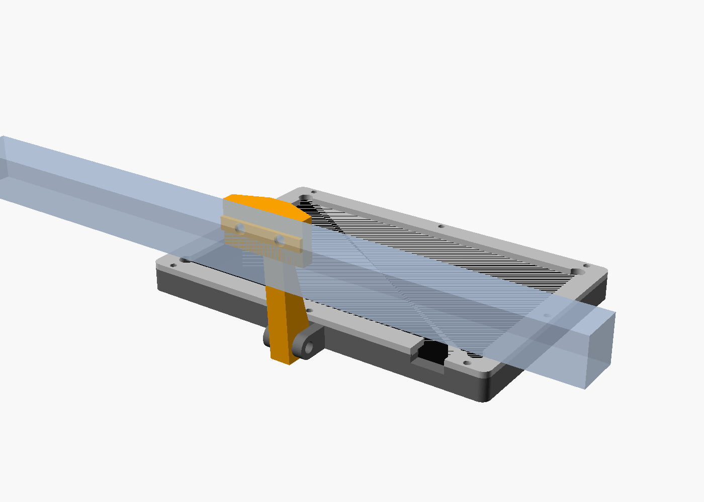
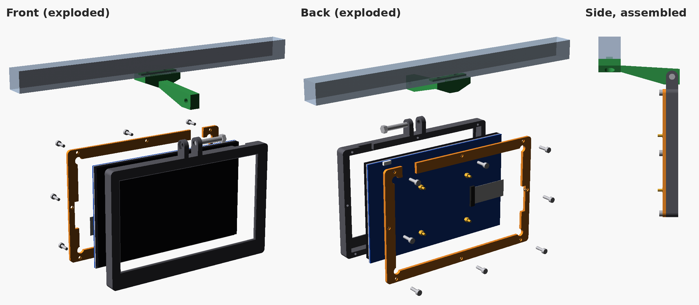

# Hosyond 7 Inch DSI Touch Screen 800x480 Case + 2020 Extrusion Mount

Printable case for the **Hosyond 7" DSI capacitive touchscreen, 800x480** (Amazon ASIN [B0D3QB7X4Z](https://www.amazon.com/dp/B0D3QB7X4Z)) with a Raspberry Pi on the back. It hangs from a 2020 aluminium extrusion on a tilting hinge (built for a Voron 2.4 front frame).

## Parts (`stl/`)

| File | What it is |
|---|---|
| `hosyond7_bezel.stl` | Front bezel with hinge forks on the top edge |
| `hosyond7_retainer.stl` | Back retainer plate (screws into the bezel) |
| `hosyond7_arm_bottom.stl` | Arm that bolts under the 2020 and reaches forward to the hinge (recommended) |
| `hosyond7_arm.stl` / `_arm_top.stl` / `_arm_end.stl` | Alternative arms: side face, top face, or extrusion end |
| `hosyond7_retainer_backforks.stl` | Alternative: hinge forks on the back plate instead of the bezel |
| `hosyond7_retainer_bottom.stl` / `_retainer_side.stl` | Alternative hinge positions (bottom edge, or short side to swivel) |

Most people need: **bezel + retainer + arm_bottom**.

## Hardware

- M3x8 or M3x10 screws (self-tap into the bezel walls) to hold the retainer
- M5 bolt + nut for the hinge
- 2x M5 T-nuts and bolts for the arm on the 2020

Tilt range is about -20 to +40 degrees.

## Customising

`hosyond7_case.scad` is fully parametric (OpenSCAD). Set `part` to the piece you want and export. Screen dimensions come from the manufacturer drawing (7inch DSI Display User Manual V1.1): 164.9 x 102.0 mm outline, 9.0 mm thick at the edge. Note the Amazon listing's 192.96 x 110.76 mm "module size" is wrong for the glass.

