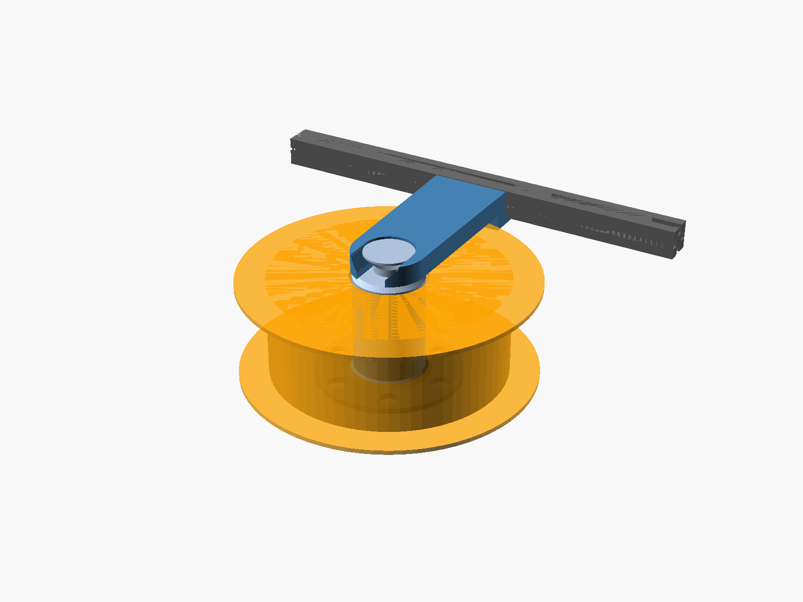
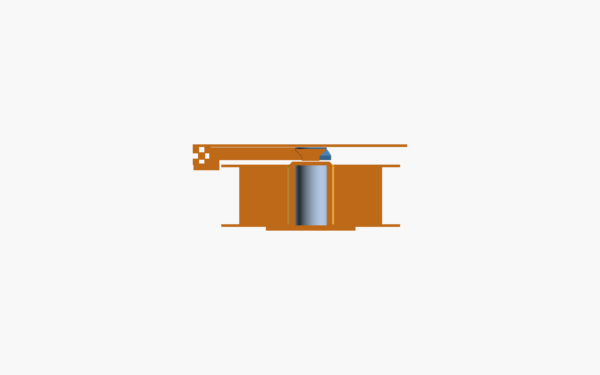
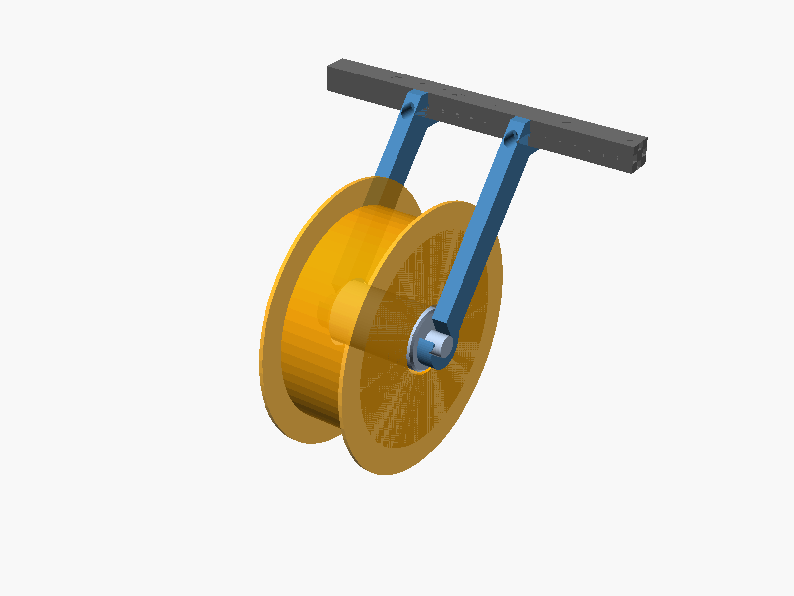

# Voron 2.4 Chamber Spool Holder

Holds a 1 kg filament spool inside the enclosed chamber of a Voron 2.4 (built for the 350 mm), hung from a top 2020 frame rail, so the chamber heat keeps the filament dry.

## 1. Flat: spool lies on its side, tucked under the top panel

`stl/1 - Flat (spool lies on its side)/`: 1x arm (print it on its side), 1x carrier (print it flange down).

- The arm bolts under a top rail and reaches out just below the top panel.
- The carrier is a hub tube with a bottom flange the spool sits on. Its cone head slides into the end of the arm from the front and drops into a 1 mm seat so it can't walk out. It turns as the filament unwinds.
- Uses about 75 mm of height below the top rail.
- To swap spools, lift the carrier slightly, slide it forward out of the arm, and lift the spool off the tube.

## 2. Hanging: spool upright between two arms

`stl/2 - Hanging (spool upright)/`: 2x arm, 1x axle. The axle drops into open hooks so the spool lifts out. Uses about 215 mm of height below the top rail.

## Z height warning

The gantry sweeps the whole chamber footprint as Z rises, so a tall print can hit the spool. Measure the gap at max Z, then lower `position_max` under `[stepper_z]` to suit. Mount it near a front corner, away from the umbilical at the back.

## Hardware

- Flat: 2x M5x10 + 2x T-nuts in the rail's bottom slot
- Hanging: 4x M5x10 + 4x T-nuts (each arm uses one in the inner-face slot and one in the bottom slot)

## Printing

ABS or ASA, because the chamber runs at 50 to 65 C and PLA or PETG will creep. 5 walls, 40% infill, no supports.

## Customising

Both OpenSCAD files are parametric (spool diameter and width, hub size, clearances). Set `part` and export:
- `flat_spool_holder.scad`: `arm`, `carrier`, `assembly`, `section`
- `hanging_spool_holder.scad`: `arm`, `axle`, `assembly`

Defaults fit a 200 x 70 mm spool with a hub of 52 mm or more.
